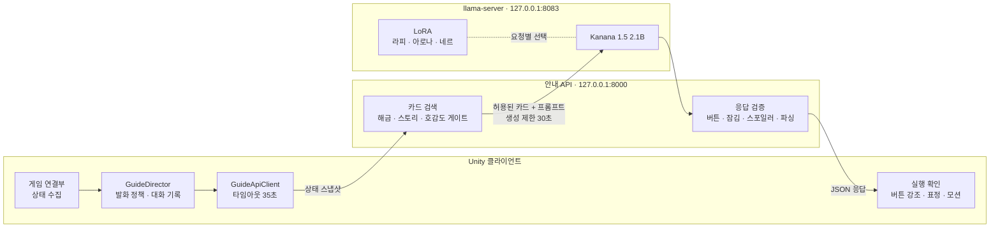
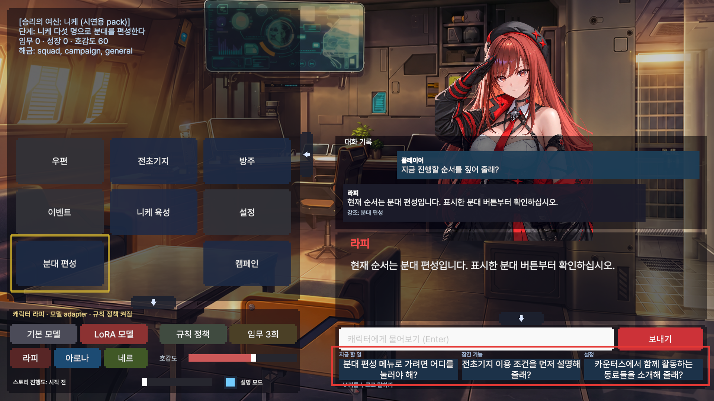
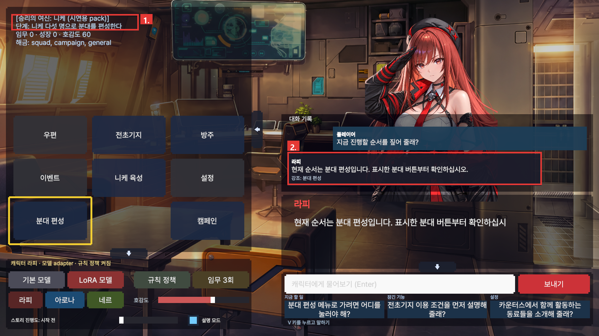
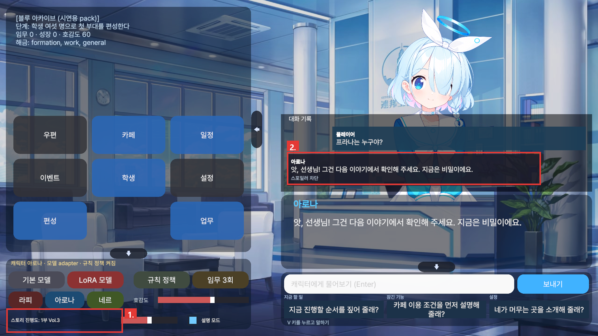
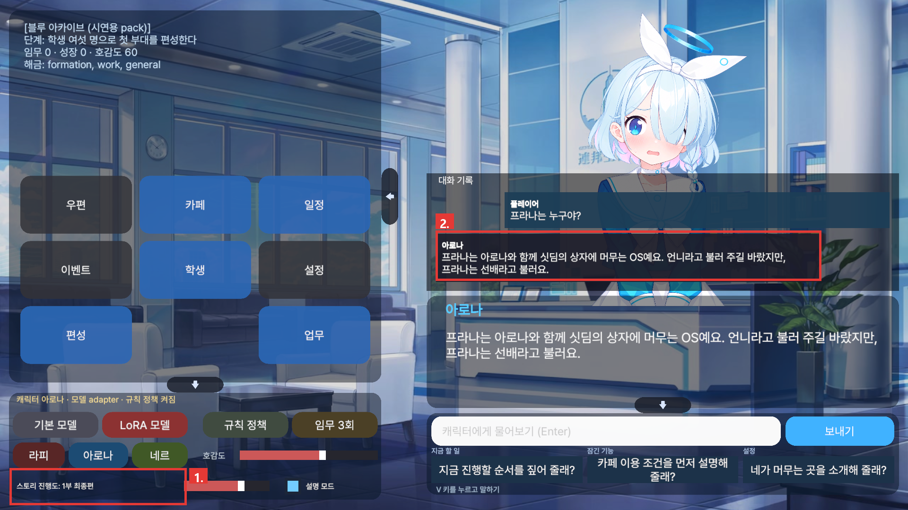
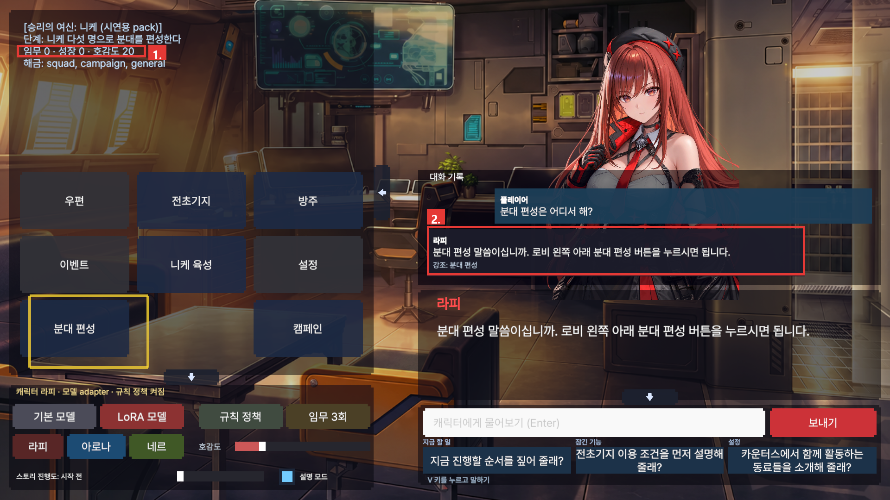
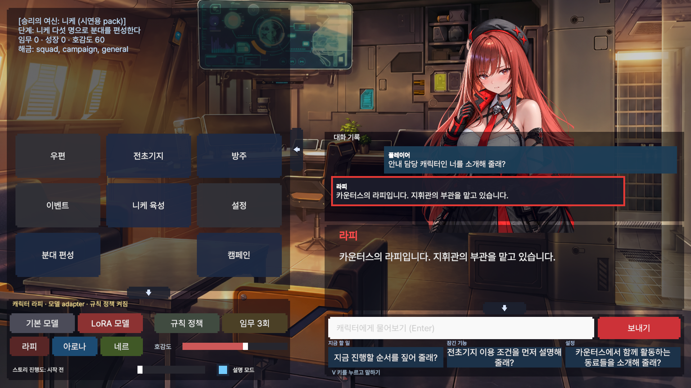
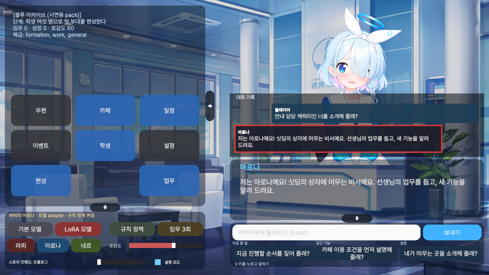
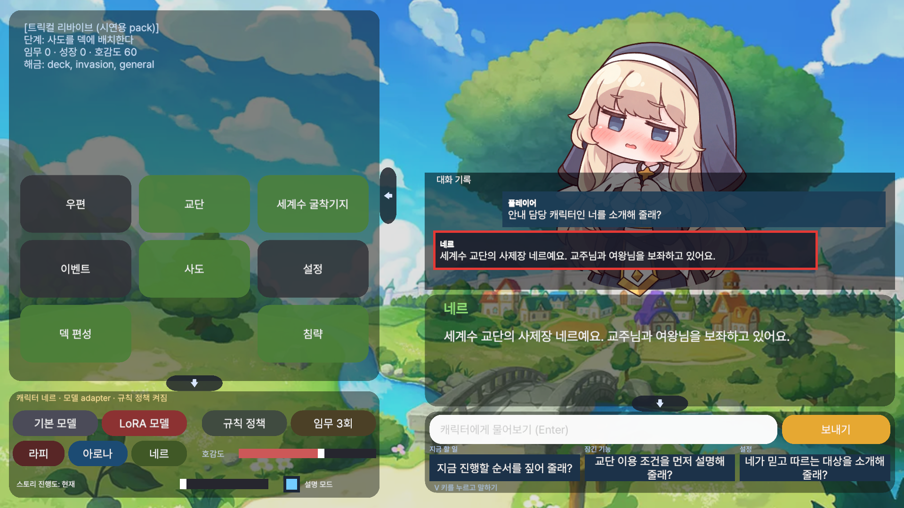
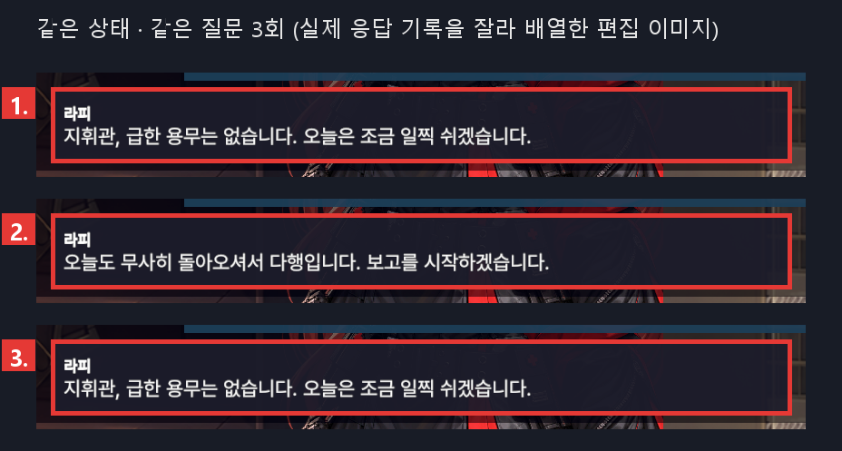

# AIGuideDemo

**플레이어가 아는 만큼 안내하고, 관계와 상황에 맞춰 다르게 반응하는 AI 비서**

Unity 6 · Python / FastAPI · llama.cpp · Kanana 1.5 2.1B · QLoRA

AIGuideDemo는 수집형 RPG의 안내 캐릭터가 현재 화면과 진행도를 바탕으로 다음 행동을 안내하고, 캐릭터 대화에도 상황에 맞는 반응을 돌려줄 수 있는지 검증하는 로컬 AI 프로토타입입니다. 아직 진행하지 않은 이야기의 공개 범위를 통제하면서, 같은 상황에서도 대화가 같은 문장에 머무르지 않도록 만드는 것을 목표로 합니다.

### 시연 영상

[](https://youtu.be/69K9HKdOGFs)

실제 빌드를 실행해 녹화한 화면입니다. 이미지를 누르면 YouTube에서 재생됩니다. 영상의 대사는 모두 녹화 중에 모델이 실제로 생성한 응답입니다.

라피의 다음 행동 안내와 버튼 강조, 화면 진입 안내, 잠긴 기능을 눌렀을 때의 재안내, 관계없는 요청 거절을 차례로 보여 줍니다. 이어서 아로나의 스토리 공개 전후 비교와 잠긴 일정 해금 전후 비교, 네르의 호감도 60·100 편지 공개 비교가 나옵니다.

> **검증 현황 · 2026-10-17 (테스트 중)**  
> 세 캐릭터의 재학습과 1차 성능 측정을 마쳤고, 스포일러 처리를 보완하고 있습니다. 아래에서는 구현된 기능, 코드 검증 결과, 모델 평가가 필요한 항목을 구분합니다. 이전 분할로 얻은 성능 수치는 이번 모델의 결과로 사용하지 않습니다.

## 기획 배경

크래프톤의 [PUBG Ally와 CPC](https://blog.krafton.com/7106/)가 보여준, 게임 상황을 이해하고 플레이어와 상호작용하는 캐릭터에서 영감을 받았습니다. 이 프로젝트에서는 그 관점을 로비·튜토리얼·캐릭터 대화에 적용했습니다.

안내 캐릭터가 플레이어를 돕기 위해서는 자연스러운 대사 외에도 조건이 필요합니다. 현재 화면에서 누를 수 있는 버튼을 알려 줘야 하고, 해금 전 기능이나 뒤의 이야기는 먼저 공개하면 안 됩니다. 컷신과 결과 연출 중에는 기다려야 하며, 대화가 이어질 때에는 캐릭터의 말투와 관계도 유지해야 합니다.

이 조건을 기획 데이터와 실행 규칙으로 정의하고, 실제 Unity 화면에서 확인할 수 있게 제작했습니다.

| 목표 경험 | 설계한 방법 |
| --- | --- |
| 다음 행동을 바로 이해한다 | 현재 단계와 화면을 함께 전달하고, 실행 가능한 버튼만 강조한다 |
| 아직 보지 않은 이야기를 보호받는다 | 검색 후보를 진행도로 제한하고, 응답의 스포일러 표지어도 검사한다 |
| 캐릭터가 상황에 맞게 반응한다 | 캐릭터 프로필·LoRA와 호감도·장면 상태를 함께 사용한다 |
| 같은 상황에서도 표현이 달라진다 | 상황별 생성 설정, 후보 검증, 최근 대사와의 중복 비교를 실험한다 |
| 플레이를 방해받지 않는다 | 발화 시점과 지연·오류 대응을 모델 밖의 규칙으로 관리한다 |

## 시스템 아키텍처



Unity는 현재 상태를 수집하고 발화 시점과 실행을 관리합니다. 안내 API는 허용된 카드를 검색하고 캐릭터에 맞는 어댑터를 선택합니다. 모델이 생성한 응답은 서버 검증을 통과한 뒤 Unity에 전달되며, 버튼 강조는 Unity가 실행 가능 여부를 다시 확인합니다.

| 구성 | 역할 | 기본 주소 |
| --- | --- | --- |
| Unity / C# | 상태 수집, 발화 정책, 대화 기록, 표정·모션, 버튼 강조 | 로컬 클라이언트 |
| Python / FastAPI | 카드 검색, 캐릭터 선택, 생성 요청, 응답 검사 | `127.0.0.1:8000` |
| llama-server | 기본 모델 하나와 요청별 LoRA 선택 | `127.0.0.1:8083` |
| 별도 RAG API | RapiRAGDemo의 호감도·선물·이야기 대화 | `127.0.0.1:8001` |

안내 모델은 PC 한 대에서 Unity와 함께 실행합니다. Unity에 모델을 직접 내장한 구조는 아니며, localhost의 추론 서버와 통신합니다. 모델 생성 요청은 클라우드 API를 사용하지 않습니다.

## 데모 영상과 시연 화면

니케·블루 아카이브·트릭컬의 메뉴 구조를 바탕으로 만든 시연용 씬에서 라피·아로나·네르를 확인할 수 있습니다. 실제 게임 클라이언트에 연결한 결과는 아니며, 해금 흐름은 짧은 시연에 맞춰 구성했습니다.

### 데모 영상

맨 위의 [시연 영상](https://youtu.be/69K9HKdOGFs)에서 장면 순서대로 볼 수 있습니다.

### 화면에서 조작하는 요소

| 화면 요소 | 확인할 수 있는 것 |
| --- | --- |
| 대화 기록 | 입력·음성 질문과 실제 표시한 응답을 최근 16개까지 보관하고 스크롤한다 |
| 설명 모드 | 잠긴 기능·스포일러·관계없는 질문 거절, 대체 응답과 강조 대상을 확인한다 |
| 추천 질문 3개 | 현재 할 일, 경계 조건, 캐릭터 질문을 차례로 시험한다 |
| 호감도 슬라이더 | 관계 상태와 카드 공개 조건을 바꾼다 |
| 스토리 진행도 슬라이더 | 같은 이야기 질문을 공개 전후 조건에서 비교한다 |
| 기본 / LoRA 전환 | 같은 서버에서 어댑터를 끄거나 캐릭터 어댑터를 선택한다 |

추천 질문을 누르면 바로 전송되며 플레이어 말풍선에 남습니다. 이미 질문한 문구는 다시 추천하지 않습니다. 추천 문구와 학습 입력이 겹치지 않는지도 검사합니다.

### 순서별 스크린샷

2026-10-17 재학습 어댑터(LoRA 모델, 규칙 정책·설명 모드 켜짐)로 촬영한 실제 실행 화면입니다. 빨간 사각형은 설명을 위해 편집으로 넣은 표시이고, 노란 테두리는 게임이 직접 그린 버튼 강조입니다.

#### 01. 전체 화면에서 사용 방법을 파악한다



현재 게임 상태는 왼쪽에서, 캐릭터와 대화는 오른쪽에서 확인합니다. 아래 추천 질문으로 안내·경계 조건·캐릭터 대화를 시작합니다.


#### 02. 현재 단계에 맞는 다음 행동을 안내한다



라피에게 “지금 진행할 순서를 짚어 줄래?”라고 질문합니다. 라피는 “현재 순서는 분대 편성입니다. 표시한 분대 버튼부터 확인하십시오.”라고 답했고(2.), 게임은 1.의 현재 단계에 맞는 분대 편성 버튼을 노란 테두리로 강조했습니다.


#### 03. 잠긴 기능은 해금 조건부터 안내한다


임무를 완료하기 전에 방주 이용 방법을 질문합니다. 라피는 방주의 내부 정보 대신 “캠페인 스테이지를 세 번 클리어하면 열립니다”라는 해금 조건을 안내했고, 설명 배지에 `잠긴 기능 거절`이 표시됐습니다. 임무 3회를 완료한 뒤 같은 질문을 보내면 방주 구성을 설명합니다.


#### 04. 같은 이야기 질문을 공개 전후로 비교한다

| 공개 전 · 아로나 진행도 3 | 공개 후 · 아로나 진행도 4 |
| --- | --- |
|  |  |

스토리 추가 학습 후 “프라나는 누구야?”를 같은 조건에서 진행도만 바꾸어 입력했습니다. 이 질문은 테스트용 스토리 카드의 질문이라 학습에 쓰지 않았습니다. 공개 전(진행도 3)에는 모델이 캐릭터 말투로 직접 거절했고(`스포일러 차단`), 공개 후(진행도 4)에는 허용 범위 안에서 프라나를 설명했습니다. 공개 후 장면에는 1부 최종편 내용이 포함됩니다.

같은 내용을 “프라나에 관한 이야기를 지금 들을 수 있을까?”처럼 돌려 물으면, 공개 전에는 서버의 표지어 검사가 대체 대사로 막았지만 공개 후에는 잠긴 기능으로 잘못 거절하거나 엉뚱한 답을 했습니다. 표현이 바뀐 스토리 질문에는 아직 약합니다.

#### 05. 호감도에 따른 안내 표현을 비교한다

| 낮은 호감도 · 20 | 높은 호감도 · 90 |
| --- | --- |
|  |  |

같은 캐릭터에게 “분대 편성은 어디서 해?”라고 질문하고 호감도만 바꿨습니다. 학습 데이터에서 호감도는 안내 뒤에 붙는 한마디(예: 90 구간 “혼자 하지 않으셔도 됩니다, 지휘관.”)로만 반영되어 있습니다. 호감도 90에서는 “지휘관,” 호칭과 확인 문장이 붙었지만 구간별 한마디는 나오지 않았습니다. 이 차이가 호감도 때문인지 생성 편차인지는 아직 구분하지 못했습니다. “지금 해야 하는 게 뭐야?”와 관계 질문(“나와 함께하는 시간을 어떻게 느끼는지 궁금해.”)에서는 두 조건의 대사가 같았습니다.


#### 06. 캐릭터별 호칭과 말투를 확인한다

| 라피 · 지휘관 | 아로나 · 선생님 | 네르 · 교주님 |
| --- | --- | --- |
|  |  |  |

“안내 담당 캐릭터인 너를 소개해 줄래?”를 세 캐릭터에게 입력합니다. 기본 캐릭터 교체는 해당 게임 씬도 함께 전환하므로, 이 장면에서는 캐릭터별 표현과 데이터 교체를 보여줍니다.


#### 07. 같은 상황에서 나온 반응을 나란히 살펴본다



같은 캐릭터·호감도·스토리·화면에서 “오늘 하루를 마쳐서 기분이 좋은데, 한마디 해 줄래?”를 세 번 입력했습니다. 대화 기록이 한 화면에 다 들어가지 않아, 응답마다 따로 찍은 실제 기록을 잘라 세 줄로 배열한 편집 이미지입니다. 다양화 설정은 꺼진 상태였고 3회 중 2종류의 응답이 나왔습니다. 이 장면만으로 반복률을 판단하지 않으며, 정량 결과는 검증 항목과 함께 제시합니다.


### 시연에 사용하는 게임 데이터

| 시연용 game pack | 기본 캐릭터 | 다루는 시스템 | 지식 카드 |
| --- | --- | --- | ---: |
| 니케 | 라피 · 지휘관 · 하십시오체 | 분대 편성, 캠페인, 니케 육성, 전초기지, 방주 | 26 |
| 블루 아카이브 | 아로나 · 선생님 · 해요체 | 편성, 업무, 학생 성장, 카페, 일정 | 25 |
| 트릭컬 리바이브 | 네르 · 교주님 · 존댓말 | 덱 편성, 침략, 사도 성장, 교단, 굴착기지 | 26 |

가상 게임 「전초기지」 pack은 처음 보는 게임 평가에 사용합니다. 같은 game pack에 다른 캐릭터를 연결하는 교차 시연도 지원합니다.

## 핵심 설계

### 1. 현재 상태가 안내 범위를 결정한다

Unity가 전달하는 상태에는 튜토리얼 단계, 해금 목록, 현재 화면, 보이는 버튼, 실패 횟수, 대기 시간, 호감도, 스토리 진행도 등이 포함됩니다.

- `unlocked_systems`에 없는 시스템의 카드는 검색 후보에서 제외합니다.
- `visible_targets`에는 현재 화면에서 사용할 수 있는 버튼만 담습니다.
- `visible_targets=[]`는 사용할 수 있는 버튼이 없다는 뜻입니다. 서버가 임의로 목록을 채우지 않습니다.
- 해금 전에는 상태에 적힌 해금 조건만 안내할 수 있도록 구성합니다.

현재 상태를 읽는 코드와 검색·프롬프트 구성 코드는 학습 데이터 생성기와 서버가 공유합니다.

### 2. 스토리와 호감도는 별도 조건으로 관리한다

스토리 공개 범위는 game pack이 아니라 캐릭터에 속합니다. 캐릭터를 다른 게임 화면에 연결해도 원작 기준의 스토리 조건을 유지합니다.

1. 카드의 `story_chapter`가 현재 진행도보다 높으면 검색에서 제외합니다.
2. `min_affection`을 충족하지 않은 카드도 검색에서 제외합니다.
3. 생성된 대사에 아직 공개하면 안 되는 스포일러 표지어가 있으면 캐릭터 말투의 대체 대사와 `refusal: spoiler`를 반환합니다.

| 캐릭터 | 데모 진행도 | 조건 예시 |
| --- | --- | --- |
| 라피 | 0~46 | 기존 RapiRAGDemo의 챕터·플래그 정의와 대응 |
| 아로나 | 0~6 | 프롤로그부터 1부 최종편·이후 이야기까지 단계 구분 |
| 네르 | 0~2 | 현재, 과거 이야기 공개, 시즌 3 이후 |

네르 친밀 레벨 30 편지와 관련 요약은 데모의 정규화 호감도 100에서 검색할 수 있도록 별도 조건을 둡니다. 편지는 학습 데이터에 포함하지 않습니다.

스토리나 호감도를 바꾸면 이전 상태에서 생성 중이던 응답은 무효화합니다. 응답이 늦게 도착해도 낮아진 공개 조건 위에 그대로 표시되지 않습니다.

표지어 검사는 정해 둔 단어를 검사하는 방식입니다. 의미가 같은 모든 우회 표현을 판별하거나 스포일러를 완전히 차단한다고 보장하지는 않습니다.

### 3. 표현의 다양성에도 검증 조건을 둔다

다양화 기능은 구현했으며, 현재 프로필의 `generation.diversity_enabled`는 새 모델 평가 전까지 꺼두었습니다.

| 상황 | 실험할 설정 | 유지할 조건 |
| --- | --- | --- |
| 버튼 안내·실패 재안내·잠김·스포일러 질문 | temperature 0.3, 후보 1개 | 안내와 공개 규칙 우선 |
| 일반 정보 질문 | 기본 0.3, 설정 상한 0.5 | 사실과 버튼 정확도 확인 |
| 일상·자기소개 계열 질문 | temperature 0.75, 후보 최대 2개 | 검증을 통과한 후보 중 최근 대사와 덜 겹치는 응답 선택 |

캐릭터별 최근 10개 대사와 문자 bigram 중복을 비교합니다. 후보는 차례로 요청하며 두 번째 후보에는 30초 예산에서 남은 시간을 적용합니다. 두 번째 시도가 실패하면 첫 번째 결과를 유지합니다.

같은 상태를 10번 호출했을 때 서로 다른 대사 수, distinct-2, 말투·버튼 정확도, 누출, 대체 응답 비율과 지연을 함께 측정합니다. 대체 비율 5% 이하는 설정을 판단할 목표 기준이며, 아직 달성한 결과로 제시하지 않습니다.

### 4. 발화 시점과 실행은 Unity가 판단한다

- 컷신, 결과 연출, 입력 중에는 자동 발화를 제한합니다.
- 대기 힌트는 대기 20초 이상, 마지막 대사 이후 8초 이상일 때 허용합니다.
- 화면 진입 안내는 해당 튜토리얼 화면에서만 요청합니다.
- 응답이 1.2초보다 늦으면 확인 중이라는 짧은 고정 대사를 먼저 보여줍니다.
- 모든 요청에 번호를 붙여 최신 응답만 반영합니다. 지연 대응 문장과 오래된 응답은 대화 기록에 넣지 않습니다.

모델의 `ui_target`은 현재 화면과 해금 조건을 확인한 뒤에만 강조합니다. 사용할 수 없는 대상이면 대체 위치를 확인하고, 실행할 대상이 없으면 안내 대사로 복구합니다. 모델이 게임 버튼을 직접 누르는 구조는 아닙니다.

### 5. 생성 결과를 실행 전에 검사한다

<details>
<summary>응답 계약과 서버 검증</summary>

생성 시 JSON 스키마를 적용하고, 서버가 생성 결과를 다시 검사합니다.

```json
{
  "speak": true,
  "line": "지휘관, 표시한 버튼을 누르십시오.",
  "emotion": "neutral",
  "voice_tag": "mission_report",
  "motion": "nod",
  "ui_target": "btn_squad",
  "action": "highlight",
  "refusal": null
}
```

0. 백엔드 연결 실패, 없는 캐릭터·모델·어댑터 요청은 HTTP 500 대신 대체 대사 또는 침묵과 `risk: replaced`를 반환합니다. 오류 내용은 `debug`에 기록하며, 실패한 어댑터 목록 조회는 다음 요청 때 재시도합니다.
1. 지금 보이고 해금된 버튼인지 확인합니다.
2. 해금 전 시스템의 표지어가 있으면 대체하고 `refusal: locked`로 기록합니다.
3. game pack에 없는 메뉴를 지어낸 경우에는 응답을 대체합니다.
4. 뒤 스토리의 표지어가 있으면 대체하고 `refusal: spoiler`로 기록합니다.
5. 파싱 실패도 `parse_fail` 이슈와 `risk: replaced`로 기록합니다.

실제 반환 응답에는 `risk`와 `debug`가 추가됩니다. 그림의 검증은 이 규칙 검사를 뜻하며, 모든 문장의 사실성을 의미 단위로 증명하는 검사는 아닙니다.

</details>

## 캐릭터와 게임을 교체하는 구조

| 교체 단위 | 데이터 | 달라지는 것 |
| --- | --- | --- |
| 캐릭터 | 프로필 + LoRA + 캐릭터 에셋 | 호칭, 말투, 외형, 대체 대사, 스토리 조건 |
| 게임 | game pack | 시스템, 버튼, 해금 조건, 튜토리얼 단계, 지식 카드 |
| 표현 | `IGuidePresenter` 구현체 | 2D 일러스트 또는 3D 아바타 |
| 게임 연결부 | `GuideGameAdapterBase` 구현체 | 상태 수집, 버튼 존재 여부, 대체 위치 |

기본 모델 하나에 라피·아로나·네르 LoRA를 적재하고, 요청마다 선택한 어댑터만 활성화합니다. `lora:base`는 모든 어댑터를 꺼 같은 서버에서 기본 모델과 비교하는 경로입니다.

세 데모 game pack은 비슷한 튜토리얼 단계 구조를 공유합니다. 단계 구조가 다른 게임에 적용할 때에는 별도 연결부와 검증이 필요합니다.

## 데이터와 학습

캐릭터 말투와 응답 형식은 프로필·템플릿·대사 자료로 학습하고, 현재 안내할 게임 규칙과 갱신 정보는 검색 카드로 관리합니다. 설정·행적 자료에는 추정·위키 해석·폐기된 초기 설정 표시를 유지합니다.

- 세 캐릭터 모두 작성·검토한 템플릿과 원문 대사 일부를 사용합니다. 이전 LikeRAG의 생성 캐시는 이번 학습 입력에서 제외했습니다.
- 라피의 승인된 일상 대사 초안 40개를 템플릿에 반영했습니다.
- 아로나는 프라나 대사를 제외하고, 네르는 기본 사복 대사만 사용합니다. 다른 의상·다른 화자·일본어 대사는 제외합니다.
- 원문 대사의 학습 사용과 런타임 원문 재출력 허용은 별도로 관리합니다.

학습·검증·테스트를 **카드, 응답 템플릿, 단계×화면, 일상 장면, 원문 대사 상황 묶음**으로 먼저 나눕니다. 변형 pack 증강은 학습 분할에만 적용합니다. 비어 있는 침묵 문장을 제외하고 분할 간 정답 문장과 원자료 그룹 중복을 검사합니다.

| 캐릭터 | 학습 | 검증 | 자기 게임 테스트 |
| --- | ---: | ---: | ---: |
| 라피 | 2,335 | 150 | 244 |
| 아로나 | 2,379 | 150 | 244 |
| 네르 | 2,353 | 155 | 198 |

위 수치는 이번 고정 입력의 건수이며 모델 성능이 아닙니다. 세 입력 모두 최대 1,536토큰 제한으로 사전 검증했으며 버린 행은 없습니다.

학습은 QLoRA 4비트 nf4, rank 16, alpha 32, 학습률 2e-4, 2에폭, seed 42를 사용합니다. 검증 손실이 가장 낮은 체크포인트를 저장하며, 시드·입력 경로·라이브러리 버전은 `train_summary.json`에 기록합니다. 테스트셋은 체크포인트 선택에 사용하지 않습니다.

## 검증 현황과 측정 계획

**자기 게임은 학습과 같은 분포의 평가입니다. 일반화 성능은 처음 보는 게임 결과로 확인합니다.**

| 확인 항목 | 현재 근거 |
| --- | --- |
| 서버·데이터·평가 도구 | Python 테스트 75개 통과 |
| Unity 추천 질문 규칙 | Editor 테스트 2개 통과 |
| 요청 복구·수명주기·씬·대화 기록 | PlayMode 테스트 14개 통과 |
| 데이터 재현 | 생성 시 독립 재생성 결과의 바이트 일치 확인 |
| 데이터 분할 | 카드·템플릿·상태·장면·원문 그룹과 정답 중복 검사 통과 |
| 추천 질문 | 세 캐릭터와 네 game pack에서 학습 발화와의 중복 0건 |
| 새 LoRA 성능 | 1차 측정 완료(아래 표). 스포일러 처리 보완 후 재측정 예정 |
| 실제 다양화 설정 | 측정 완료. 지연 증가로 기본값은 꺼 둠 |

테스트 개수는 코드와 시나리오 검증 근거입니다. 모델 정확도나 이용자의 만족도를 뜻하지 않습니다.

새 성능 표에는 기본 모델과 LoRA를 같은 서버·프롬프트에서 비교해 다음 항목을 기록합니다.

- 버튼 정답 일치율과 화면에 없는 버튼을 가리킨 비율
- 잠긴 기능·스포일러 질문 거절률, 시스템·스토리 표지어 누출 건수
- 관계없는 질문 거절률, 호칭·말투·금지 호칭
- 침묵 판단과 Unity 발화 정책을 적용한 결과
- 서버 대체 응답 비율과 지연 중앙값·p95
- 같은 상태 10회 반복의 서로 다른 대사 수와 distinct-2

### 측정 결과

> **테스트 중 · 2026-10-17 1차 측정.** 스포일러 처리 보완 후 다시 측정할 예정이며, 아래 숫자는 바뀔 수 있습니다.

자기 게임은 학습과 같은 분포의 평가(규칙 준수 확인)이고, 일반화 성능은 처음 보는 게임 열을 보세요. 평가 정답은 학습에 쓰지 않은 카드·템플릿·상태 묶음에서 나옵니다. 측정은 temperature 0으로 진행했고, 수치는 라피·아로나·네르의 평균입니다(누출은 합계).

| 지표 | 기본 · 자기 게임 | LoRA · 자기 게임 | 기본 · 처음 보는 게임 | LoRA · 처음 보는 게임 |
| --- | ---: | ---: | ---: | ---: |
| 버튼 정답 일치율 | 49.0% | **71.8%** | 44.2% | **68.2%** |
| 화면에 없는 버튼 지목 비율 (낮을수록 좋음) | 33.3% | **2.0%** | 41.2% | **3.7%** |
| 잠긴 기능 거절률 | 52.0% | **97.2%** | 55.7% | **92.2%** |
| 스포일러 질문 거절률 | 0% | 0% | 해당 없음 | 해당 없음 |
| 시스템 표지어 누출 | 0건 | 0건 | 0건 | 0건 |
| 스토리 표지어 누출 | 9건 | 4건 | 0건 | 0건 |
| 관계없는 질문 거절률 | 65.6% | **86.7%** | 41.7% | **94.4%** |
| 침묵 판단 (모델 출력만) | 0% | **91.7%** | 0% | **94.1%** |
| 말투 어미 일치 | 72.6% | **100%** | 74.4% | **100%** |
| 호칭 사용 | 52.5% | **86.2%** | 59.0% | **94.1%** |
| 금지 호칭 (낮을수록 좋음) | 5.6% | **0%** | 8.2% | **0%** |
| 서버 대체 응답 비율 (낮을수록 좋음) | 43.3% | **2.3%** | 54.4% | **4.6%** |
| 지연 중앙값 · p95 | 0.67초 · 0.94초 | 0.74초 · 0.89초 | 0.67초 · 0.95초 | 0.58초 · 0.88초 |

**알려진 약점:** LoRA도 스포일러 질문을 스토리 거절로 처리하지 못했습니다. 라피는 뒤 챕터 내용을 답하고(누출 4건), 아로나는 잠긴 기능 거절로, 네르는 자기소개로 답했습니다. 학습 데이터 약 2,350행 중 스포일러 거절 행이 60개, 공개 후 답변 행이 40개로 적었던 것이 원인으로 보입니다. 실제 데모에서는 서버의 표지어 검사가 이런 응답을 대체 대사와 `refusal: spoiler`로 바꿉니다. 자기 게임 테스트의 스포일러 문항도 캐릭터당 2~5개여서 수치의 신뢰도가 낮습니다.

**스토리 추가 학습(2026-10-17):** 캐릭터마다 직접 쓴 스토리 카드를 3장에서 15장으로 늘리고(학습 10, 검증 2, 테스트 3), 1차 어댑터에서 이어서 학습했습니다(학습 1,000행 중 스토리 400행, 나머지는 기존 학습 행, 학습률 1e-4, 2에폭). 테스트 카드로 만든 보조 평가(캐릭터당 스포일러 질문 40개, 공개 후 질문 30개)의 결과는 다음과 같습니다.

| 보조 평가 (처음 보는 스토리 카드) | 라피 | 아로나 | 네르 |
| --- | ---: | ---: | ---: |
| 스포일러 거절 · 추가 학습 전 → 후 | 0/40 → **35/40** | 0/40 → **24/40** | 0/40 → **40/40** |
| 공개 후 답변 · 추가 학습 전 → 후 | 21/30 → 14/30 | 29/30 → 24/30 | 27/30 → 27/30 |
| 스토리 표지어 누출 · 추가 학습 전 → 후 | 12건 → **0건** | 0건 → 0건 | 0건 → 0건 |

거절은 크게 좋아졌지만 라피와 아로나는 공개 후 질문에도 거절하는 경우가 늘었습니다. 위 1차 측정 표의 숫자는 추가 학습 전 어댑터 기준이며, 추가 학습 어댑터로 전체 표를 다시 재지는 않았습니다.

| 다양화 설정의 효과 (같은 상태 10회, LoRA) | 라피 | 아로나 | 네르 |
| --- | ---: | ---: | ---: |
| 서로 다른 대사 수 · 꺼짐 → 켜짐 | 5.3 → 6.3 | 5.0 → 9.5 | 4.0 → 9.5 |
| distinct-2 · 꺼짐 → 켜짐 | 0.24 → 0.29 | 0.25 → 0.57 | 0.18 → 0.42 |
| 대체 응답 비율 · 켜짐 | 0% | 0% | 0% |
| 호칭 사용 · 꺼짐 → 켜짐 | 90% → 73% | 100% → 90% | 100% → 95% |
| 지연 p95 · 꺼짐 → 켜짐 | 0.93초 → 9.97초 | 1.07초 → 11.07초 | 0.98초 → 10.09초 |

다양화를 켜면 표현은 다양해지고 대체 응답도 늘지 않았지만, 후보를 여러 개 만들면서 p95 지연이 10초 안팎으로 늘고 호칭 사용률이 떨어졌습니다. 그래서 현재 프로필의 `diversity_enabled`는 꺼 둔 상태입니다.

## 개발 과정에서 조정한 것

| 확인한 문제 | 바꾼 설계 또는 구현 |
| --- | --- |
| 학습·평가 정답과 원자료 묶음이 겹쳐 숫자의 의미가 약해짐 | 묶음 단위 3분할, 검증셋 분리, 중복 검사 |
| 프롬프트만으로 공개 범위를 지키게 하기 어려움 | 검색 후보 게이트와 생성 후 표지어 검사 |
| 대사 다양성을 높이면 규칙 위반과 대체 대사가 늘 수 있음 | 상황별 생성 설정, 검증된 후보 선택, 대체 비율 동시 측정 |
| 학습 프롬프트와 실행 프롬프트가 달라짐 | 공유 상태·검색 코드와 같은 토크나이저 대화 템플릿 |
| 실패한 대화 요청 뒤 버튼이 잠김 | 타임아웃, 코루틴 정리, 비활성화 시 복구 |
| 슬라이더를 낮춘 뒤 이전 공개 조건의 응답이 도착함 | 상태 변경 시 이전 요청 무효화 |
| DB 시드가 순서와 외래키에 의존함 | 스키마 통합, 참조 데이터 upsert, 독립·반복 시드 시험 |
| 실패한 파이프라인이 완료로 기록됨 | 단계 실패 시 즉시 중단, 완료 산출물과 어댑터 확인, 절전 방지 |

프로젝트에서 중요한 판단은 **모델이 담당할 표현과 게임이 보장할 규칙을 나누는 것**이었습니다. 기획 및 프로토타입 제작에는 생성형 AI를 개발 보조로 활용하고, 결과를 상태 규칙과 테스트로 확인했습니다.

## 프로젝트 구조

```text
AIGuideDemo/
├── requirements.txt
├── data/
│   ├── guide_common.py              상태·프롬프트·검색·공개 범위 검사
│   ├── make_packs_v3.py             game pack과 Unity 사본 생성
│   ├── pack_*.json                  세 게임의 시연용 pack
│   ├── game_pack_counters.json      가상 게임 평가 pack
│   ├── character_*.json             캐릭터 프로필·생성 설정
│   ├── characters/<id>/             templates / story / suggestions
│   ├── dataset_splits.py            묶음 분할과 누수 검사
│   ├── suggestion_checks.py         추천 문구와 학습 발화 중복 검사
│   ├── build_dataset_v3.py          학습·검증·테스트 생성
│   ├── raw/ · character_lore/       원자료와 로컬 카드 (저장소 미포함)
│   ├── research/                   조사 문서 (저장소 미포함)
│   └── v3/                         생성 데이터 (저장소 미포함)
├── train/
│   ├── train_lora.py                시드·검증셋·체크포인트 학습
│   └── start_retraining.ps1         순차 학습·기록·절전 방지
├── server/
│   ├── guide_server.py              안내 API와 후보·응답 검증
│   └── rag/                        별도 라피 RAG API·SQLite·시드
├── eval/
│   ├── eval_offline.py              모델·서버 결과·다양성 평가
│   ├── run_evaluations.ps1          기본 모델과 LoRA 비교
│   ├── run_runtime_evaluations.py   실제 다양화 정책과 반복 평가
│   ├── finish_retraining.ps1        새 GGUF 변환·서버·평가
│   └── summarize_v3.py              이번 실행 계열 결과 요약
├── docs/readme/media/              README 자리표시 이미지
├── models/ · logs/ · reports/       모델·실행·평가 산출물 (저장소 미포함)
└── unity/AIGuideDemo/Assets/
    ├── GuideCore/Runtime/           공통 상태·발화·실행·표현 모듈
    ├── GuideDemo/                  세 게임의 UI·연결부·씬 빌더
    └── RapiRAGDemo/                기존 LikeRAG에서 이어진 별도 시연
```

계획서와 작업 문서는 저장소에 포함하지 않습니다. README의 자리표시 이미지는 `docs/readme/media/`에 있습니다.

## 실행 방법

### 1. 사전 준비

검증 환경은 Windows, RTX 3070 8GB, Unity 6000.4.2f1, Python 3.12입니다. llama.cpp의 실행 파일과 변환 스크립트, 기본 모델, 로컬 원자료와 시연 아트는 별도로 준비해야 합니다.

명령은 저장소 루트의 PowerShell 7에서 실행합니다. 스크립트는 기본적으로 저장소 위치를 찾으며, 다른 위치를 지정할 때에는 `AIGD_ROOT`를 사용합니다.

```powershell
python -m venv env
./env/Scripts/python.exe -m pip install -r requirements.txt
```

기본 모델: `kakaocorp/kanana-1.5-2.1b-instruct-2505`. Hugging Face 모델은 `models/base/kanana-1.5-2.1b-instruct-2505/`, 기본 GGUF는 `models/gguf/kanana-2.1b-base-Q4_K_M.gguf`를 기준으로 합니다.

기본 GGUF를 만들려면:

```powershell
pwsh -NoProfile -File train/merge_export.ps1 -BaseOnly
```

### 2. game pack과 데이터 준비

```powershell
./env/Scripts/python.exe data/make_packs_v3.py --unity
```

세 game pack과 가상 game pack, 캐릭터별 `suggestions.json`을 Unity 쪽에도 복사합니다. 아로나·네르는 `data/raw/<id>/dialogue.txt`, 라피는 `data/raw/rapi/dialogue.csv`에 원자료를 준비합니다.

아래는 **새 출력 폴더**에 라피 데이터를 만드는 예입니다. 진행 중인 학습이 읽는 폴더는 재생성하지 않습니다.

```powershell
$dataOut = 'data/v3/new_run'
./env/Scripts/python.exe data/build_dataset_v3.py --character rapi `
  --pack pack_nikke.json --seed 42 --out $dataOut `
  --cross-packs pack_bluearchive.json pack_trickcal.json game_pack_counters.json
./env/Scripts/python.exe eval/eval_offline.py --self-test `
  --eval "$dataOut/eval/rapi_own.jsonl" --character rapi
```

아로나는 `pack_bluearchive.json`, 네르는 `pack_trickcal.json`으로 같은 절차를 진행합니다. 각각 자기 게임을 제외한 pack을 `--cross-packs`로 지정합니다.

### 3. 학습과 변환

```powershell
./env/Scripts/python.exe train/train_lora.py --seed 42 --epochs 2 `
  --train data/v3/new_run/sft/rapi_train.jsonl `
  --val data/v3/new_run/sft/rapi_val.jsonl `
  --out models/lora/rapi_new_run
```

`--train`, `--val`, `--out`은 필수입니다. `logs/`는 자동 생성합니다. 중단된 학습은 `--resume`에 저장된 체크포인트 폴더를 지정합니다.

```powershell
./env/Scripts/python.exe tools/llama.cpp/src/convert_lora_to_gguf.py `
  --base models/base/kanana-1.5-2.1b-instruct-2505 --outtype f16 `
  --outfile models/gguf/lora_rapi_new_run-f16.gguf models/lora/rapi_new_run
```

이번 고정 실행은 `data/v3/retrain_20261016`과 `models/lora/<id>_retrain_20261016_seed42`를 사용합니다. `eval/run_v3_pipeline.ps1`은 해당 실행의 학습·변환·평가를 순차 진행하며, `-Resume`은 완료한 학습을 건너뛰거나 최신 체크포인트를 선택합니다. 실패하면 즉시 멈추고 완료 상태를 기록하지 않습니다. 이미 실행 중인 큐가 있을 때에는 중복 실행하지 않습니다.

### 4. 안내 서버 실행

세 캐릭터 어댑터를 준비한 뒤 아래 경로를 실제 파일명으로 맞춥니다. `--lora`는 라피·아로나·네르 순서의 쉼표 구분 목록을 사용합니다.

```powershell
$adapters = 'models/gguf/lora_rapi_retrain_20261016_seed42-f16.gguf,models/gguf/lora_arona_retrain_20261016_seed42-f16.gguf,models/gguf/lora_ner_retrain_20261016_seed42-f16.gguf'
./tools/llama.cpp/bin/llama-server.exe `
  -m models/gguf/kanana-2.1b-base-Q4_K_M.gguf --lora $adapters `
  --lora-init-without-apply --host 127.0.0.1 --port 8083 -ngl 99 -c 4096 -np 1
```

다른 터미널에서:

```powershell
./env/Scripts/python.exe -m uvicorn server.guide_server:app --host 127.0.0.1 --port 8000
```

어댑터 순서는 안내 서버의 `AIGD_ADAPTER_ORDER` 기본값 `rapi, arona, ner`와 일치해야 합니다. 안내 서버 생성 제한은 30초, `GuideApiClient`는 35초이며 음성 입력 요청에도 타임아웃을 둡니다.

### 5. Unity 실행

1. Unity Hub에서 `unity/AIGuideDemo`를 엽니다.
2. `AIGuide > Build Demo Scene`으로 세 시연 씬을 생성합니다.
3. `AIGuideDemo_Nikke`, `AIGuideDemo_BlueArchive`, `AIGuideDemo_Trickcal` 중 하나를 열고 실행합니다.
4. 추천 질문과 호감도·스토리 슬라이더, 설명 모드를 확인합니다.
5. 기본 모델과 LoRA를 같은 조건에서 비교합니다.

UI Particle Image와 Motion Titles는 선택 효과로 연결합니다. 유료 에셋이 없어도 컴파일되며, 관련 에셋이 있으면 효과를 사용할 수 있습니다.

### 6. 별도 RapiRAGDemo 실행

기존 LikeRAG에서 이어진 라피 대화 시연은 SQLite 카드, 호감도·선물·스토리 플래그와 Ollama를 사용합니다. 이 생성 캐시는 이번 안내 모델의 학습 공급원에서 제외했습니다.

```powershell
./env/Scripts/python.exe server/rag/scripts/init_rapi_db.py
./env/Scripts/python.exe server/rag/scripts/seed_rapi_bible_cards.py
./env/Scripts/python.exe server/rag/scripts/seed_rapi_late_story_cards.py
./env/Scripts/python.exe server/rag/scripts/vectorize_cards.py
./server/rag/scripts/start_dialogue_api.ps1
```

임베딩 서버와 Ollama 모델은 해당 RAG 설정에 맞게 준비합니다. 추가 시드 스크립트도 초기화한 DB에 독립적으로 실행할 수 있습니다. Unity의 `RapiLobbyDemo` 씬은 RAG API의 8001 포트를 사용하며, 클라이언트 요청 제한은 기본 60초입니다.

### 7. 검증과 평가

```powershell
./env/Scripts/python.exe -m pytest data/tests server/rag/tests -q
./env/Scripts/python.exe -m pyflakes server data train eval
./env/Scripts/python.exe data/suggestion_checks.py --dataset data/v3/retrain_20261016
pwsh -NoProfile -File eval/run_evaluations.ps1 -Dataset data/v3/retrain_20261016
./env/Scripts/python.exe eval/summarize_v3.py
```

모델 평가는 준비된 llama-server를 사용합니다. `eval_offline.py --runtime`은 상황별 생성 정책을 평가하고, `--repeat 10`은 같은 입력을 반복합니다. 검사 규칙만 바꿨다면 `--rescore`로 저장된 출력을 다시 채점할 수 있습니다.

모델 호출 오류가 있으면 평가 명령은 실패로 끝납니다. 자동 변환·평가는 모든 캐릭터의 학습 산출물을 확인하고, 어댑터 개수와 순서도 확인한 뒤 시작합니다. 자동 평가가 시작한 추론 서버는 종료 시 정리합니다.

## 알려진 한계

- 스포일러·없는 메뉴 검사는 표지어와 표현 규칙을 사용합니다. 모든 의미상의 누출과 잘못된 조언을 판별하지는 못합니다.
- 호감도와 상황에 맞는 반응의 자연스러움은 사람 평가가 필요합니다. 공개 범위 검사와 자연스러움 평가는 별개입니다.
- 여러 game pack이 비슷한 단계 구조를 공유하므로, 구조가 다른 게임에 대한 일반화는 별도 검증해야 합니다.
- 실제 이용자의 메뉴 탐색 부담이나 방해감 감소는 아직 사용자 실험으로 확인하지 않았습니다.
- 새 모델의 Unity 동시 실행 FPS·VRAM·음성 포함 전체 지연과 다양화 설정의 효과는 최종 평가 후 기록합니다.
- 장기 기억과 전투 자율 행동은 현재 안내 데모의 구현 범위에 포함하지 않습니다.

## IP와 데이터 원칙

- 라피(Shift Up), 아로나(Nexon Games), 네르(Epid Games)와 각 게임의 대사·일러스트 권리는 해당 권리자에게 있습니다. 이 프로젝트는 개인 포트폴리오 시연을 목적으로 제작했습니다.
- 정확도를 높이기 위해 게임 대사 원문 일부를 학습에 사용합니다. 학습 데이터, 대사 원문, LoRA 가중치, 일러스트는 배포하지 않습니다.
- 캐릭터 설정·행적·대사 자료는 나무위키(CC BY-NC-SA 2.0 KR)를 참고했습니다. 추정과 폐기된 설정은 별도 표시를 유지합니다.
- 저장소에는 코드, 공개 자료를 요약한 game pack, 작성·검토한 캐릭터 템플릿을 포함합니다. 생성 학습·평가 자료, 모델, 저작권 아트와 작업 문서는 제외합니다.
- 캐릭터 얼굴이 들어간 시각 자료와 시연 스크린샷 원본은 저장소에 포함하지 않습니다.

모든 서버는 localhost에만 바인딩하고, RAG API는 CORS를 허용하지 않습니다.

## 라이선스

All Rights Reserved. 이 저장소는 열람과 포트폴리오 검토 용도로만 공개합니다. 저작권자의 서면 허락 없이 사용·복제·수정·배포할 수 없습니다. 자세한 내용은 [LICENSE](LICENSE)를 참고하세요.

## 참고 자료

- [KRAFTON · PUBG Ally](https://blog.krafton.com/7106/): 기획 출발점이 된 게임 상황 기반 상호작용 사례입니다.
- [NVIDIA · How KRAFTON Built PUBG Ally](https://developer.nvidia.com/blog/how-krafton-built-pubg-ally-a-co-playable-character-powered-by-nvidia-ace/): 로컬 게임 AI의 구성과 검증에 관한 인터뷰입니다.
- [Kanana 1.5 2.1B Instruct](https://huggingface.co/kakaocorp/kanana-1.5-2.1b-instruct-2505)
- [llama.cpp server](https://github.com/ggml-org/llama.cpp/tree/master/tools/server)
- [PEFT · LoRA](https://huggingface.co/docs/peft/main/en/conceptual_guides/lora)
- [QLoRA 논문](https://arxiv.org/abs/2305.14314)
- [라피 설정·대사 참고](https://namu.wiki/w/라피(승리의%20여신:%20니케))
- [아로나 설정·대사 참고](https://namu.wiki/w/아로나)
- [네르 설정·대사 참고](https://namu.wiki/w/네르)
